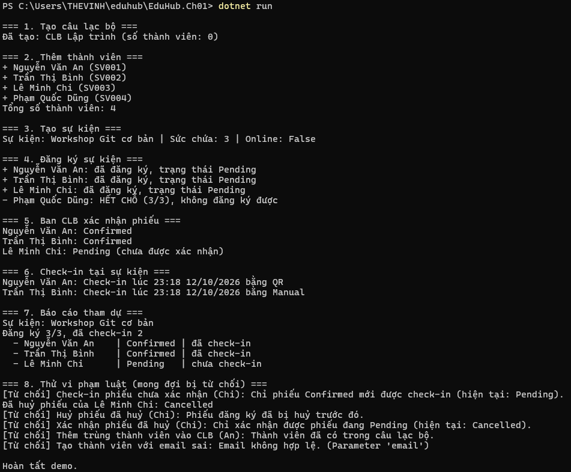

# EduHub

Hệ thống quản lý câu lạc bộ và sự kiện sinh viên. Đây là bài tập Chương 01 môn *Phát triển phần mềm hướng đối tượng* (IN421107): phân tích yêu cầu và xây dựng mô hình miền (domain model) bằng C#.

**Sinh viên:** <Phan Thế Vinh> — **MSSV:** 0024418356

## Nội dung bài làm

| Phần | Nội dung | Vị trí |
|---|---|---|
| User Stories | 6 story, 3 vai trò, mỗi story có tiêu chí nghiệm thu | [docs/user-stories.md](docs/user-stories.md) |
| Sơ đồ lớp | 5 class, quan hệ và khoá ngoại (Mermaid) | [docs/class-diagram.md](docs/class-diagram.md) |
| Domain classes | Member, Club, Event, Registration, CheckIn | [EduHub.Ch01/Domain](EduHub.Ch01/Domain) |
| Console demo | Luồng đăng ký, xác nhận, check-in và báo cáo | [EduHub.Ch01/Program.cs](EduHub.Ch01/Program.cs) |

## Cấu trúc thư mục

```
eduhub/
├── docs/
│   ├── user-stories.md
│   ├── class-diagram.md
│   └── demo.png
├── EduHub.Ch01/
│   ├── Domain/
│   │   ├── Enums.cs
│   │   ├── Member.cs
│   │   ├── Club.cs
│   │   ├── Event.cs
│   │   ├── Registration.cs
│   │   └── CheckIn.cs
│   └── Program.cs
└── README.md
```

## Cách chạy

Yêu cầu: cài .NET SDK theo hướng dẫn của môn học.

```bash
git clone https://github.com/vinhbautroi08/eduhub.git
cd eduhub/EduHub.Ch01
dotnet run
```

## Kết quả chạy



Chương trình mô phỏng 8 bước: tạo CLB, thêm thành viên, tạo sự kiện (sức chứa 3), đăng ký, xác nhận, check-in, in báo cáo tham dự, rồi thử các thao tác vi phạm luật nghiệp vụ và xác nhận chúng bị từ chối.

## Thiết kế

- Thuộc tính dùng `private set`, constructor `private`, đối tượng tạo qua `Create()` có kiểm tra dữ liệu đầu vào.
- Trạng thái dùng `enum` (`MemberStatus`, `RegistrationStatus`) thay vì chuỗi.
- `Club` giữ danh sách thành viên ở dạng `IReadOnlyList<Member>`, muốn thêm phải gọi `AddMember()`.

### Luật nghiệp vụ chính

- Phiếu đăng ký: `Pending → Confirmed`; có thể huỷ từ Pending hoặc Confirmed; phiếu đã huỷ không thể huỷ lại hay xác nhận.
- Chỉ phiếu `Confirmed` mới được check-in.
- Sự kiện hết chỗ khi số phiếu còn hiệu lực đạt sức chứa.
- Thành viên phải có tên, email hợp lệ và mã số sinh viên.
