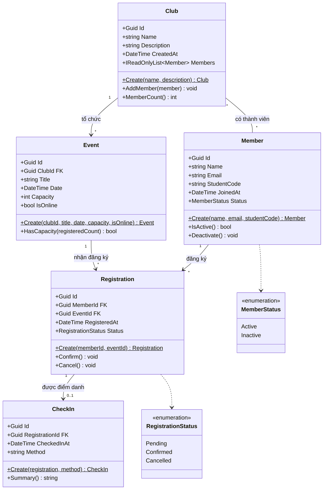

# Sơ đồ lớp — EduHub (Ch01)

**Tác giả:** <Phan Thế Vinh> — 0024418356

## 1. Sơ đồ

## 2. Bảng quan hệ và khoá ngoại

| Quan hệ | Bội số | Khoá ngoại | Ghi chú |
|---|---|---|---|
| Club — Member | * — * | bảng trung gian `ClubMember` (làm ở Ch04) | Ch01: `Club` giữ danh sách `Members` |
| Club — Event | 1 — * | `Event.ClubId` | Một CLB tổ chức nhiều sự kiện |
| Member — Registration | 1 — * | `Registration.MemberId` | Một thành viên có nhiều phiếu |
| Event — Registration | 1 — * | `Registration.EventId` | Một sự kiện nhận nhiều phiếu |
| Registration — CheckIn | 1 — 0..1 | `CheckIn.RegistrationId` | Có thể chưa check-in |

## 3. Giải thích thiết kế

- Phía "nhiều" giữ khoá ngoại (FK), phía "một" chỉ là nơi được tham chiếu tới.
- Khoá chính của mọi entity là `Id` kiểu `Guid`.
- Tiêu đề (`Title`) và sức chứa (`Capacity`) là thuộc tính của `Event`, không phải entity riêng vì chúng không có hành vi và không tồn tại độc lập.
- Trạng thái dùng enum (`MemberStatus`, `RegistrationStatus`) thay vì chuỗi để tránh gõ sai.
- Vòng đời `Registration`: Pending → Confirmed → (CheckIn); Cancel() được phép từ Pending hoặc Confirmed.
- Ký hiệu `$` sau tên method là method `static` (factory `Create`).
